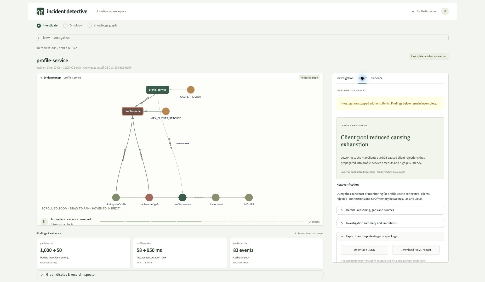

# Incident Detective

Investigate a service **as it was at a particular time**. A bounded LangGraph agent follows
dependencies in Neo4j, checks observations and changes, and produces hypotheses with inspectable
evidence and a next verification step.


This is a local SRE lab with **synthetic systems, code and events**. The prepared graph demonstrates
temporal investigation; a separate importer demonstrates continuous construction from local exports.
No production systems are connected.

## Showcase

The graph stays in view as you follow checks, review the report and inspect its sources.
The screenshots show a real GPT-5 mini investigation marked incomplete; its hypothesis remains provisional.

**Report:** a provisional hypothesis, explicit incomplete status and a next verification action.



**Measurements:** prior/incident values and inspectable source records.


**Ontology:** approved entity properties and relationship directions.


**Stored graph:** actual dependency records with provenance inspection and pagination.


See [capture details](docs/screenshots/README.md) for the run mode and dataset.

## Explore the demo

The app has three workspaces:

| View | What to inspect |
| --- | --- |
| **Investigate** | Hypotheses, selected checks, returned evidence, diagnosis and dependency graph |
| **Ontology** | Entity types, properties and permitted relationship directions |
| **Knowledge graph** | Searchable stored records, their actual edges and source provenance |

Open **New investigation**, choose **Profile instability**, then click **Investigate →**.
The evidence map stays on the left; the adjacent **Investigation** panel shows actual checks in
order. Open **Hypotheses & check details** for the full assessments. **Report** contains the provisional
diagnosis, next verification and JSON/HTML downloads. **Evidence** contains measurements, original
messages, state history and running code. Finding cards below the map show cited source values.

The workspace uses warm off-white surfaces, muted forest/sage accents and a scrollable side panel.
Ontology, graph browsing and standalone reports share the same local, system-font theme.

Try the other prepared questions:

| Question | What it exercises |
| --- | --- |
| Payments · 3 AM | Dependencies, infrastructure changes and baseline/incident/recovery measurements |
| Payments · now | Checking whether the reported symptom is present after recovery |
| Billing errors | Release and code provenance along an upstream dependency path |

The demo clock is **23 October 2026, 10:05 Europe/Berlin**. “Now” and “today” use that clock;
“3AM today” means `2026-10-23T01:00:00Z`. In **Investigation settings**, switch to **Known at the
time** to exclude records learned later. **Evidence only** retrieves the graph without a model call.

For a 90-second walkthrough: show the ontology, investigate Profile instability, inspect one check
and its source records, then contrast historical Payments with Payments now. A supported hypothesis
still requires independent verification.

## How it works

1. Resolve the service and requested time against graph identities.
2. Retrieve immediate topology, target observations and relevant confirmed historical findings.
3. Let the model choose a typed evidence check; fixed, parameterized Cypher runs through a local,
   read-only Neo4j MCP process. Model output never becomes executable Cypher.
4. Assess support, contradictions and gaps; continue within the budget or package the result.
5. Validate structure, citations, entities and numerical claims, then render the retrieved graph.

The loop permits at most **3 hypotheses, 8 checks, 10 model calls and 3 dependency hops**, with a
180-second investigation budget. Exhausted budgets return incomplete evidence packages; transport or
validation failures preserve evidence and mark analysis unavailable.
The light dashboard and graph visualization use local styles and inline PyVis assets.
LangSmith tracing and usage telemetry are disabled.

The current temporal graph uses [`knowledge/ontology.v2.json`](knowledge/ontology.v2.json) and
[`data/temporal_scenarios.json`](data/temporal_scenarios.json). The local-export importer uses the
earlier ontology and a separate namespace; **it does not yet feed the temporal workspace**.
See [architecture and configuration](docs/architecture.md) and
[graph construction from local exports](docs/ingestion.md).

## Run locally

Requires Python 3.11–3.13, [uv](https://docs.astral.sh/uv/), Docker with a running engine, and
[Ollama](https://ollama.com/). Initial dependency, image and model downloads need internet access.
The default model is intended for an Apple Silicon Mac with 24 GB memory.

First run:

```bash
./bootstrap.sh
```

The bootstrap installs locked dependencies, creates a private `.env` if needed, starts Neo4j and
Ollama, downloads missing local weights, seeds the graph, checks MCP/structured inference, and starts
Streamlit. It preserves existing configuration and data. Docker's engine must already be running.

Subsequent runs use installed artifacts and enforce local inference:

```bash
./run.sh
```

Use `--setup-only` to prepare services without starting the dashboard, `--evidence-only` to run with
model interpretation disabled, or `--port 8502` if another dashboard is already running. The scripts
do not stop unrelated processes. Neo4j and a bootstrap-started Ollama remain available after Ctrl-C.

Open **[Incident Detective](http://localhost:8501)**. Neo4j Browser is at
[localhost:7474](http://localhost:7474); use username `neo4j` and the password in your private `.env`.

Both scripts select Ollama by default. Settings are read fresh from `.env`; explicit shell variables
take precedence. The local model defaults are:

```dotenv
LLM_PROVIDER=ollama
OLLAMA_HOST=http://localhost:11434
OLLAMA_MODEL=qwen2.5:14b-instruct
LANGSMITH_TRACING=false
```

Compose runs Neo4j Community **2026.10.0**, binds its ports to loopback and preserves data in named
volumes. Seeding is scoped and idempotent; `docker compose stop` stops the database without deleting
its data. Model selection is explicit: an optional OpenAI-compatible provider is also implemented,
and sends retrieved evidence to the configured endpoint. There is no automatic provider fallback.
Using that provider through the setup launcher requires an explicit shell override:

```bash
LLM_PROVIDER=openai OPENAI_MODEL=gpt-5-mini ./bootstrap.sh --port 8502
```

This mode sends evidence to the configured model endpoint and requires network access. `run.sh`
rejects remote inference throughout the app session, including later file edits.

## Command-line investigations

```bash
# Retrieve evidence without inference.
uv run python temporal_demo.py ask "What was wrong with payments API at 3AM today?" --evidence-only

# Run the bounded hypothesis loop using the provider configured in .env.
uv run python temporal_demo.py ask "Why is profile service unstable?" --output artifacts/profile

# Replay using only knowledge available at the incident time.
uv run python temporal_demo.py ask "What was wrong with payments API at 3AM today?" --mode known_then
```

Each run writes `investigation.json` and `report.html`. Use `--at` for an explicit ISO timestamp and
`--transport bolt` to use the Python driver instead of MCP. Time parsing supports AM/PM expressions
and explicit overrides; it is not a general natural-language date parser.

## Verify

```bash
uv run ruff check .
uv run pytest -q -m 'not integration and not llm'
RUN_NEO4J_TESTS=1 uv run pytest -q -m 'not llm'
uv run python scripts/verify_temporal.py

# Optional: execute the five cases with the configured model.
uv run python scripts/verify_temporal.py --with-model
```

The verifier writes reports under `artifacts/temporal-verification`. Its default mode runs real
Neo4j/MCP retrieval without inference. Model-backed checks are separate from deterministic tests;
valid output structure does not establish a correct root cause.

## Run offline

Complete `./bootstrap.sh` once, then disconnect the internet while keeping localhost available:

```bash
./run.sh
```

Check that hypotheses and graphs render without external asset requests. The verifier denies
nonlocal Python sockets in Ollama mode. For macOS process-level network isolation and runtime
limitations, see [offline operation](docs/architecture.md#offline-operation).

## Project guide

- [`agent/investigation_loop.py`](agent/investigation_loop.py): StateGraph decisions and budgets.
- [`knowledge/temporal_queries.py`](knowledge/temporal_queries.py): time-scoped retrieval.
- [`knowledge/diagnostic_tools.py`](knowledge/diagnostic_tools.py): the four typed evidence tools.
- [`agent/skills/temporal-diagnosis/SKILL.md`](agent/skills/temporal-diagnosis/SKILL.md): diagnostic policy.
- [`ui/temporal_workspace.py`](ui/temporal_workspace.py): navigation and investigation lifecycle.
- [`ui/case_view.py`](ui/case_view.py): evidence canvas and investigation/report/evidence panel.
- [`ui/activity.py`](ui/activity.py), [`ui/diagnosis.py`](ui/diagnosis.py): timeline and result detail.
- [`knowledge/explorer.py`](knowledge/explorer.py): scoped, paginated graph browsing.
- [`ingestion/`](ingestion/): local-export adapters and transactional checkpoints.
- [Cleanup review](docs/cleanup-review.md): implemented changes, verification and remaining limitations.

The original two-incident prototype is preserved at Git tag **`dummy_data`**. The current app opens
the temporal lab. Production adapters for the temporal ontology, retention/archiving and sustained
capacity testing remain future work.
