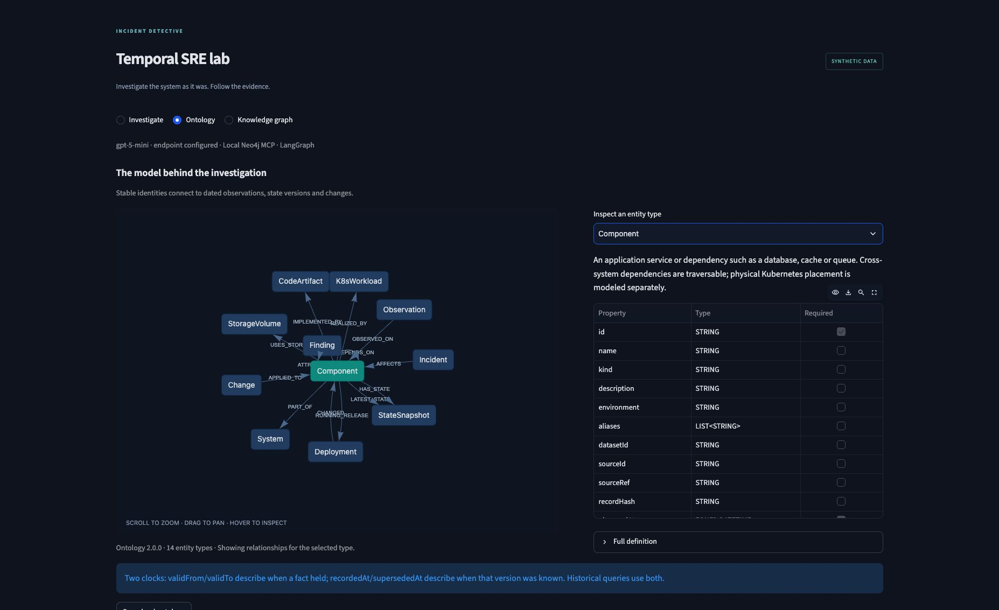
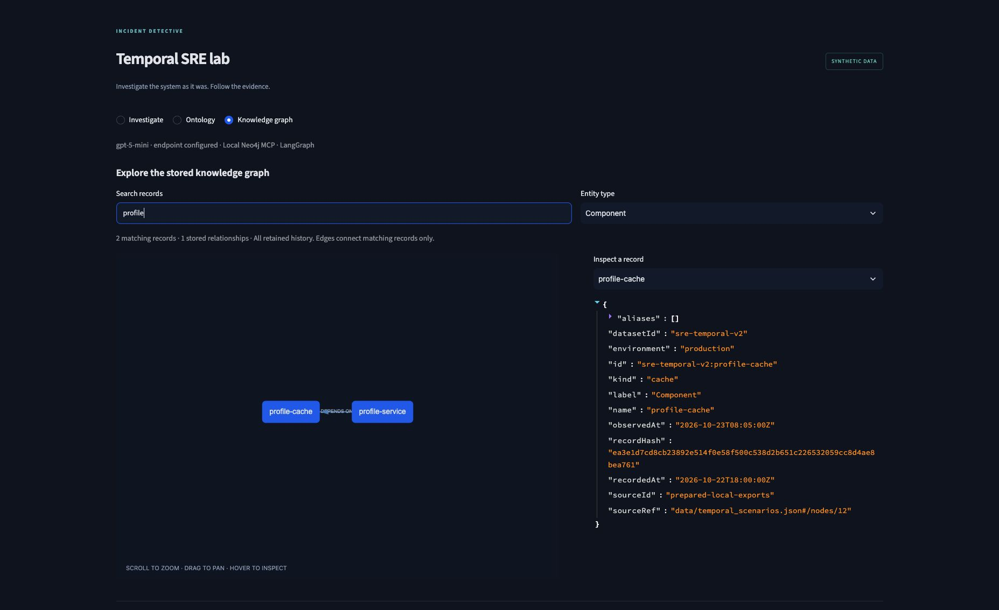
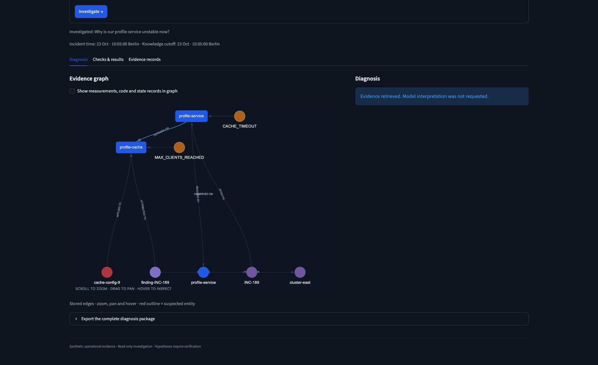
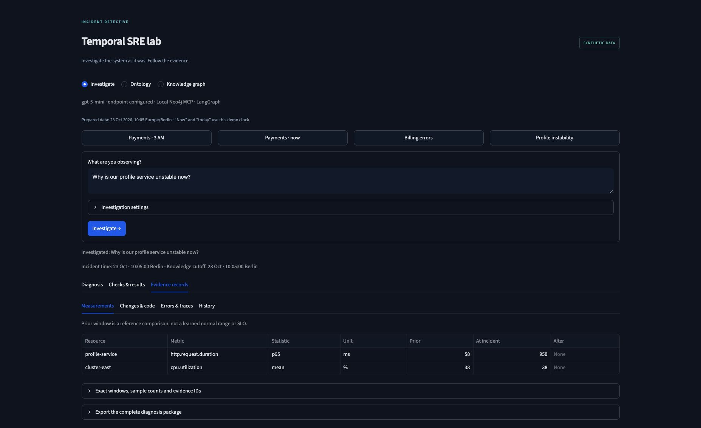

# App screenshots

[Back to README](../../README.md)

Captured from the running Streamlit app at `http://localhost:8501` on **24 October 2026**.
All records are synthetic. The investigation used **Evidence only**: Neo4j/MCP retrieval ran,
and no model request was made. The provider label reflects the existing app configuration.

## Ontology

The approved Component definition, its permitted relationship directions and property types.

## Stored knowledge graph

The Component view filtered to `profile`: two stored records, one dependency edge, and the cache
record's identity, timestamps and source reference.

## Investigation evidence graph

A completed evidence-only Profile investigation. Dependencies, symptoms, changes and historical
findings are retrieved; the analysis panel explicitly reports that interpretation was not requested.

## Measurements

Retrieved prior/incident measurements. The prior window is a reference comparison, not a learned
baseline. No hypothesis or confidence score was generated for this run.

